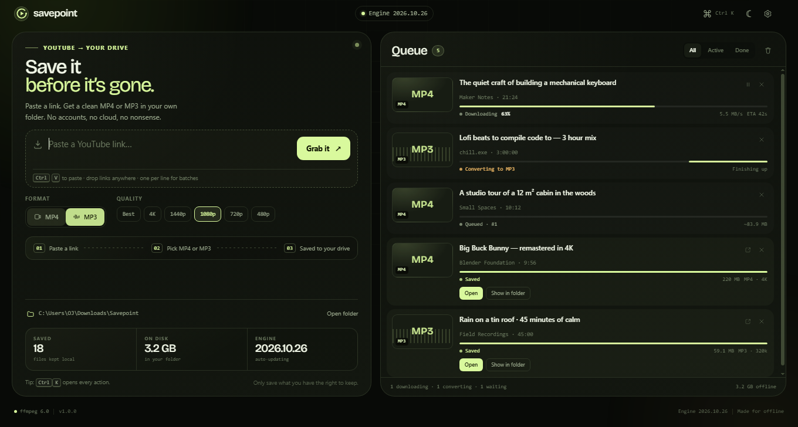

<p align="center">
  
</p>

<h1 align="center">Savepoint</h1>

<p align="center"><strong>Save it before it’s gone.</strong><br />
A small, fast Windows app that saves YouTube video as MP4 or audio as MP3 — straight to your own folder.</p>

<p align="center">
  <a href="https://github.com/fsocietyshinjuu/savepoint/releases/latest"></a>
  <a href="LICENSE"></a>
  
  <a href="https://fsocietyshinjuu.github.io/savepoint/"></a>
</p>



## What it does

- **MP4 or MP3.** Pick a resolution (up to 4K) or a bitrate (up to 320 kbps). Savepoint fetches the best matching streams and merges them with ffmpeg.
- **Your folder, not the cloud.** Files land in `Downloads\Savepoint` unless you point it somewhere else. Nothing is uploaded.
- **A queue you can steer.** Pause, resume, retry, cancel, clear. Live progress, speed, ETA, and human-readable errors.
- **Batch and playlists.** Paste several links at once, drop them on the window, or turn on playlist mode (up to 100 videos).
- **Keyboard first.** `Ctrl` + `K` for the command palette, `Ctrl` + `V` to pull a link from the clipboard, `Enter` to queue.
- **Two themes.** Phosphor (dark) and Paper (light), following Windows if you prefer.
- **Lite mode.** Detects a low-core / low-RAM machine and drops glow, blur, and animation. Downloads run one at a time by default.
- **Updates itself.** Checks GitHub Releases every four hours, asks before downloading, installs on restart. The yt-dlp engine updates on demand when YouTube changes.

## Download

Grab the latest installer from **[Releases](https://github.com/fsocietyshinjuu/savepoint/releases/latest)** — `Savepoint-Setup-<version>.exe`.

- Windows 10 or 11, 64-bit.
- No admin rights required: it installs per user and keeps the updatable engines in `%APPDATA%\Savepoint`.
- Windows SmartScreen may warn because the build is not code-signed. Choose *More info → Run anyway*.

## How it works

```
src/main/main.js        Electron main process, window, IPC, lifecycle
src/main/preload.js     contextBridge API (no node in the renderer)
src/main/downloads.js   queue, metadata, progress parsing, yt-dlp orchestration
src/main/binaries.js    engine seeding + yt-dlp self-update from GitHub
src/main/settings.js    validated JSON settings
src/main/history.js     local library index
src/main/updates.js     electron-updater wiring
src/main/links.js       resolves landing/source links from release-info.json
src/renderer/           vanilla HTML, CSS, and JS interface
resources/bin/          bundled yt-dlp.exe + ffmpeg.exe (generated)
scripts/                icon generation, asset fetch, release prep, screenshots
landing/                static project page deployed to GitHub Pages
```

The renderer has no framework and no Node access. Everything privileged goes through a narrow, validated IPC surface. Downloads run as child processes and are killed as a process tree on cancel so yt-dlp and ffmpeg never linger.

### Engines

`npm run assets` copies a static ffmpeg build into `resources/bin` and downloads the current `yt-dlp.exe` from its GitHub release. The packaged app seeds a writable copy into `%APPDATA%\Savepoint\bin` on first launch and can replace it with a newer release later, without touching Program Files.

## Build from source

Requirements: Node.js 20+ on Windows.

```powershell
npm install
npm run assets     # icons, fonts, ffmpeg, yt-dlp
npm start          # run the app
npm run dist       # build the NSIS installer into dist\
```

`npm run capture` boots the app in capture mode and writes the store screenshots to `landing/assets/`.

### Release

```powershell
git tag v1.0.1
git push origin v1.0.1
```

Pushing a `v*` tag runs `.github/workflows/release.yml`, which stamps the version from the tag, builds on Windows, publishes the installer and `latest.yml` to GitHub Releases, and lets installed apps auto-update. The landing page is published from `landing/` by `.github/workflows/pages.yml`.

The owner and repository name come from `package.json`; `scripts/prepare-release.mjs` writes `electron-builder.generated.yml` and `src/main/release-info.json` from it.

## Privacy

- No analytics, no accounts, no tracking.
- Settings and history are JSON files in `%APPDATA%\Savepoint`.
- Network access is limited to YouTube (via yt-dlp), GitHub's release API for engine updates, and GitHub Releases for app updates.

## Legal

Savepoint is an independent tool. It is **not affiliated with, endorsed by, or sponsored by YouTube**. Only download media you own or have permission to save, and respect the platform’s terms and local copyright law. The authors take no responsibility for misuse.

## Third-party

- [yt-dlp](https://github.com/yt-dlp/yt-dlp) — Unlicense
- [ffmpeg](https://ffmpeg.org) — GPL (Windows build from [ffmpeg-static](https://github.com/eugeneware/ffmpeg-static))
- [Electron](https://www.electronjs.org) — MIT
- [Bricolage Grotesque](https://github.com/atelier-anchor/bricolage) — SIL Open Font License

Savepoint itself is [MIT licensed](LICENSE).
